# 1 计算机系统概述
## 1.2 计算机系统层次结构
### 1.2.1 计算机系统组成
硬件系统和软件系统共同构成了一个完整的计算机系统。对某一功能来说， 若其既可⽤软件实现，又可⽤硬件实现，则称为软/硬件在逻辑功能上是等价的。

在设计计算机系统时，要进⾏软/硬件的功能分配。通常来说，⼀个功能若使⽤较为频繁且⽤硬件实现的成本较为理想，则使⽤硬件解决可以提⾼效率。

### 1.2.2 计算机硬件
1. 冯·诺依曼机基本思想
冯•诺依曼在研究EDVAC机时提出了“存储程序”的概念，“存储程序”的思想奠定了现代计算机的基本结构，以此概念为基础的各类计算机统称冯•诺依曼机，其特点如下：
1）采⽤“存储程序”的⼯作⽅式。
2）计算机硬件系统由运算器、存储器、控制器、输⼊设备和输出设备5⼤部件组成。
3）指令和数据以同等地位存储在存储器中，形式上没有区别，但计算机应能区分它们。
4）指令和数据均⽤⼆进制代码表⽰。
5）指令由操作码和地址码组成，操作码指出操作的类型，地址码指出操作数的地址

“存储程序”的基本思想是：将事先编制好的程序和原始数据送⼊主存储器后才能执⾏，一旦程序被启动执⾏，就⽆须操作⼈员的⼲预码指，计算机会⾃动逐条执⾏指令，直⾄程序执⾏结束。

2. 计算机功能部件
    1. 输入设备
    输入设备的主要功能是将程序和数据以机器所能识别和接受的信息形式输入计算机
    2. 输出设备
    输出设备的任务是将计算机处理的结果以⼈们所能接受的形式或其他系统所要求的信息形式输出
    3. 存储器
    存储器分为主存储器（也称内存储器或主存）和辅助存储器（也称外存储器或外存）。CPU能够直接访问的存储器是主存储器。辅助存储器⽤于帮助主存储器记忆更多的信息，辅助存储器中的信息必须调⼊主存储器后，才能为CPU所访问。主存储器的⼯作⽅式是按存储单元的地址进⾏存取，这种存取⽅式称为按地址存取⽅式。

    存储器地址寄存器（MAR）存放访存地址，经过地址译码后找到所选的存储单元。存储器数据寄存（MDR）⽤于暂存要从存储器中读或写的信息，时序控制逻辑⽤于产⽣存储器操作所需的各种时序信号。

    每个存储单元包含若⼲存储元件，每个存储元件存储⼀位⼆进制代码“0”或“1”。因此存储单元可存储⼀串⼆进制代码，称这串代码为存储字，称这串代码的位数为存储字长，存储字长可以是I B（8 b i t）或是字节的偶数倍。

    MAR⽤于寻址，其位数反映最多可寻址的存储单元的个数，如MAR为10位，则最多有2的10方=1024个存储单元，记为1K。MAR的长度与PC的长度相等。
    MDR的位数通常等于存储字长，⼀般为字节的2次幂的整数倍。

    4. 运算器
    运算器是计算机的执⾏部件，⽤于进⾏算术运算和逻辑运算。算术运算是按算术运算规则进⾏的运算，如加、减、乘、除；逻辑运算包括与、或、⾮、异或、⽐较、移位等运算。

    运算器的核⼼是算术逻辑单元。运算器包含若⼲通⽤寄存器，⽤于暂存操作数和中间结果，如累加器（ACC）、乘商寄存器（MQ）、操作数寄存器（X）、变址寄存器（IX）、基址寄存器（BR）等，其中前三个寄存器是必须具备的。
    运算器内还有程序状态寄存器（PSW），也称标志寄存器，⽤于存放A L U运算得到的⼀些标志信息或处理机的状态信息

    5. 控制器
    控制器是计算机的指挥中⼼，由其“指挥”各部件⾃动协调地进⾏⼯作。控制器由程序计数器（PC）、指令寄存器（IR）和控制单元（CU）组成。

    PC⽤来存放当前欲执⾏指令的地址，具有⾃动加L的功能（这⾥的“⼯”指⼀条指令的长度），即可⾃动形成下⼀条指令的地址，它与主存储器的M A R之间有⼀条直接通路。

    IR⽤来存放当前的指令，其内容来⾃主存储器的M D R。指令中的操作码OP（IR）送⾄CU，⽤以分析指令并发出各种微操作命令序列；⽽地址码Ad（IR）送往MAR，⽤以取操作数。一般将运算器和控制器集成到同⼀个芯⽚上，称为中央处理器（CPU）。CPU和主存储器共同构成主机，⽽除主机外的其他硬件装置（外存、1/0设备等）统称外部设备，简称外设。

    CPU包含ALU、通⽤寄存器组GPRs、标志寄存器、控制器、指令寄存器（IR）、程序计数器（PC）、存储器地址寄存器（MAR）和存储器数据寄存器（MDR）
    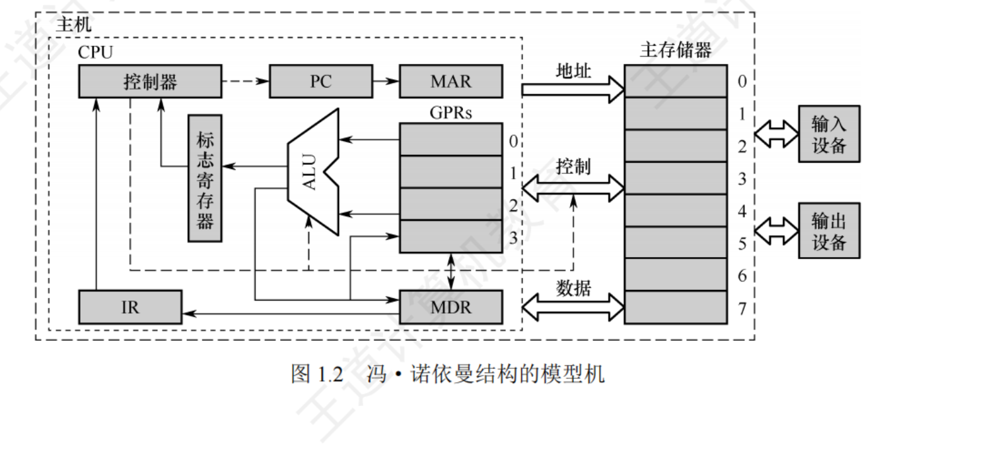

### 1.2.3 计算机软件
1. 系统软件和应用软件
系统软件是⼀组保证计算机系统⾼效、正确运⾏的基础软件，通常作为系统资源提供给⽤户使⽤。系统软件主要有操作系统（OS）、数据库管理系统（DBMS）、语⾔处理程序、分布式软件系统、⽹络软件系统、标准库程序、服务性程序等。
应⽤软件是指⽤户为解决某个应⽤领域中的各类问题⽽编制的程序，如各种科学计算类程序、⼯程设计类程序、数据统计与处理程序等。

2. 三个级别的语言
    1）、机器语⾔。也称⼆进制代码语⾔，需要编程⼈员记忆每条指令的⼆进制编码。机器语⾔是计算机唯⼆可以直接识别和执⾏的语⾔。
    2）汇编语⾔。汇编语⾔⽤英⽂单词或其缩写代替⼆进制的指令代码。使⽤汇编语⾔编局的程序，必须经过⼀个称为汇编程序的系统软件翻译，将其转换为机器语⾔程序后，才能在计算机的硬件系统上执⾏。
    3）⾼级语⾔。⾼级语⾔（如C、C++、Java等）可以⽅便程序设计⼈员写出解决问题的处理⽅案和解题过程的程序。通常⾼级语⾔需要经过编译程序编译成汇编语⾔程序，然后经过汇编操作得到机器语⾔程序，或直接由⾼级语⾔程序翻译成机器语⾔程序。

    翻译程序有以下三类；
        1）汇编程序（汇编器）。将汇编语⾔程序翻译成机器语⾔程序。
        2）解释程序（解释器）。将源程序中的语句按执⾏顺序逐条翻译成机器指令并⽴即执⾏。
        3）编译程序（编译器）。将⾼级语⾔程序翻译成汇编语⾔或机器语⾔程序。

3. 软件和硬件的逻辑功能等价性
    对某⼀功能来说，其既可以由硬件实现，又可以由软件实现，从⽤户的⾓度来看，它们在功能上是等价的。这⼀等价性被称软/硬件逻辑功能的等价性。

### 1.2.4 计算机系统的层次结构
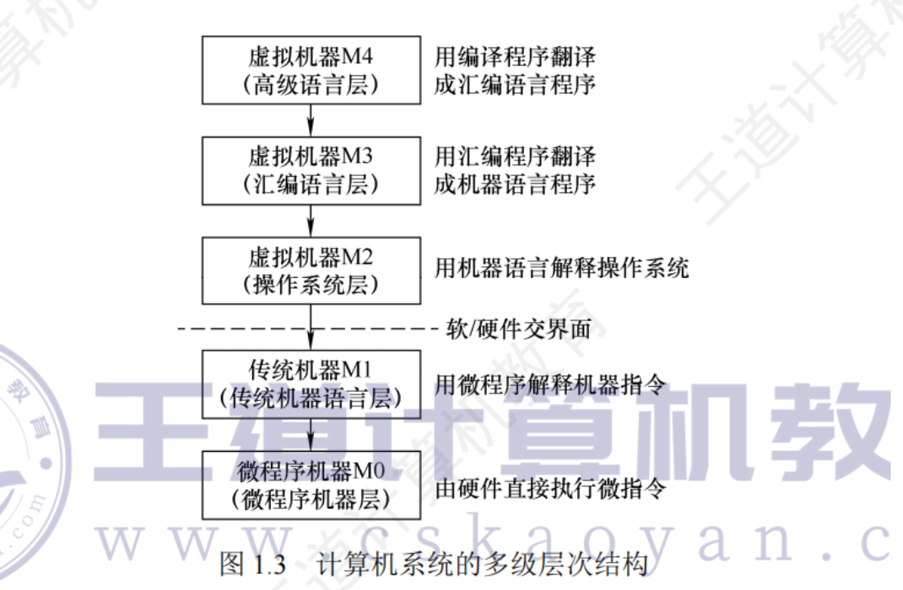
第1级是微程序机器层，这是⼀个实在的硬件层，它由机器硬件直接执⾏微指令。

第2级是传统机器语⾔层，它也是⼀个实际的机器层，由微程序解释机器指令系统。

第3级是操作系统层，它由操作系统程序实现。操作系统程序是由机器指令和⼴义指令组成的，这些⼴义指令是为了扩展机器功能⽽设置的，是由操作系统定义和解释的软件指令，所以这⼀层也称混合层。

第4级是汇编语⾔层，这⼀层由汇编程序⽀持和执⾏，借此可编写汇编语⾔源程序。

第5级是⾼级语⾔层，它是⾯向⽤户的，是⽅便⽤户编写应⽤程序⽽设置的。该层由各种⾼级语⾔编译程序⽀持和执⾏.

没有配备软件的纯硬件系统称裸机。第3层～第5层称为虚拟机器，简单来说就是软件实现的机器。

层次之间的关系紧密，下层是上层的基础，上层是下层的扩展。

软件和硬件之间的界⾯就是指令集体系结构（ISA），ISA定义了⼀台计算机可以执⾏的所有指令的集合，每条指令规定了计算机执⾏什么操作，以及所处理的操作数存放的地址空间和操作数类型。可以看出，ISA是指软件能感知到的部分，也称软件可见部分。

### 1.2.5 计算机系统的工作原理
1. “存储程序”工作方式
“存储程序”⼯作⽅式规定，程序执⾏前，需要将程序所含的指令和数据送⼊主存储器，⼀旦程序被启动执⾏，就⽆须操作⼈员的⼲预，⾃动逐条完成指令的取出和执⾏任务

每条指令的执⾏过程包括：根据PC从主存储器中取指令、对指令进⾏译码、计算下⼀条指令地址、取操作数并执⾏、将结果送回存储器。
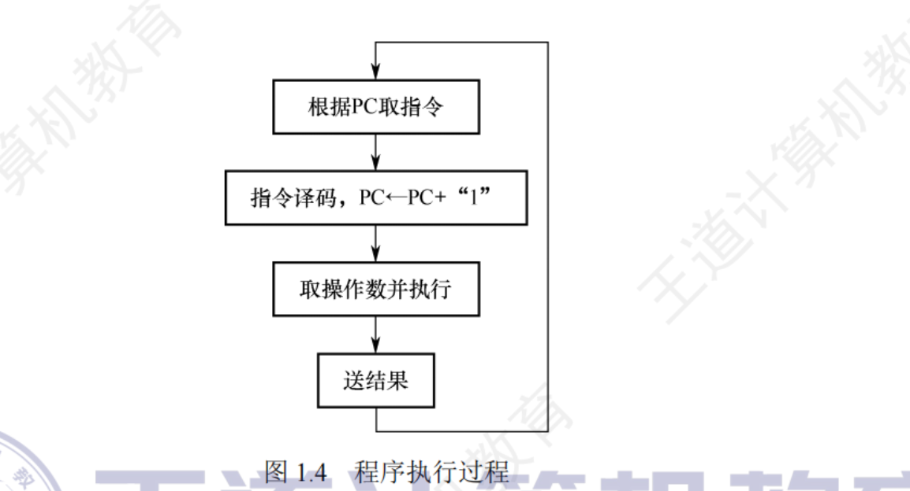

2. 从源程序到可执行文件
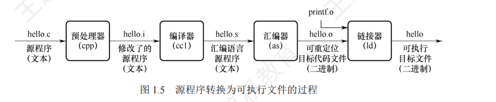
1）预处理阶段：预处理器（cpp）对源程序中以字符#开头的命令进⾏处理，例如将#include命令后⾯的.h⽂件内容插⼊程序⽂件。输出结果是⼀个以i为扩展名的源程序hello.i。
2）编译阶段：编译器（ccl）对预处理后的源程序进⾏编译，⽣成⼀个汇编语⾔源程序hello.s。汇编语⾔源程序中的每条语句都以⼀种⽂本格式描述了⼀条低级机器语⾔指令。
3）汇编阶段：汇编器（as）将hello.s翻译成机器语⾔指令，把这些指令打包成⼀个称为可重定位⽬标代码⽂件hello.0，它是⼀种⼆进制⽂件，因此⽤⽂本编辑器打开会显⽰乱码。
4）链接阶段：链接器（Id）将多个可重定位⽬标代码⽂件和标准库函数合并为⼀个可执⾏⽬标⽂件，简称可执⾏⽂件。本例中，链接器将hello.o和标准库函数printf所在的可重定位⽬标模块printf。合并，⽣成可执⾏⽂件hello。最终⽣成的可执⾏⽂件被保存在磁盘上。

3. 指令执行过程的描述
可执⾏⽂件中的代码段是由⼀条⼀条机器指令构成的，指令是⽤0和1表⽰的⼀串0/1序列，⽤来指⽰CPU完成⼀个特定的原⼦操作下⾯以取数指令（送⾄运算器的A C C中）为例来说明，其信息流程如下：
1）取指令：PC-MAR-M-MDR-IR

根据PC.取指令到IR。将PC的内容送MAR，MAR中的内容直接送地址线，同时控制器将读信号送读/写信号线，主存储器根据地址线上的地址和读信号，从指定存储单元读出指令，送到数据线上，MDR从数据线接收指令信息，并传送到IR中。
2）分析指令：OP（IR）-CU

指令译码并送出控制信号。控制器根据IR中指令的操作码，⽣成相应的控制信号，送到不同的执⾏部件。在本例中，IR中是取数指令，因此读控制信号被送到总线的控制线上。
3）执⾏指令：Ad（IR）-MAR-M-MDR-ACC

取数操作。将IR中指令的地址码送MAR，MAR中的内容送地址线，同时控制器将读信号送读/写信号线，从主存储器中读出操作数，并通过数据线送⾄MDR，再传送到ACC中。

每取完⼀条指令，还需为取下⼀条指令做准备，计算下⼀条指令的地址，即（PC）+1-PC。

## 1.3 计算机的性能指标
### 1.3.1 计算机的主要性能指标
1. 机器字长
通常所说的“某16位或32位机器”，其中的16、32指的是机器字长，简称字长。字长是指计算机进⾏⼀次整数运算（定点整数运算）所能处理的⼆进制数据的位数，通常与CPU的寄存器位数、ALU有关。因此，字长⼀般等于通⽤寄存器的位数或ALU的宽度，字长越长，数的表⽰范围越⼤，计算精度越⾼。计算机字长通常选定为1字节（8位）的整数倍。

2. 数据通路带宽
数据通路带宽是指数据总线⼀次所能并⾏传送信息的位数。这⾥所说的数据通路宽度是指外部数据总线的宽度，它与CPU内部的数据总线宽度（内部寄存器的⼤⼩）有可能不同。

3. 主存容量
主存容量是指主存储器所能存储信息的最⼤容量，通常以字节（B）来衡量，也可⽤字数x字长（如512K×16位）来表⽰存储容量。其中，MAR的位数反映了存储单元的个数，MDR的位数反映了存储单元的字长。

4. 运算速度
1）吞吐量和响应时间。
    吞吐量。指系统在单位时间内处理请求的数量。它取决于信息能多快地输⼊内存，CPU能多快地取指令，数据能多快地从内存取出或存⼊，以及所得结果能多快地从内存送给外部设备。及乎每步都关系到主存储器，因此系统吞吐量主要取决于主存储器的存取周期。
    响应时间。指从⽤户向计算机发送⼀个请求，到系统对该请求做出响应并获得所需结果的等待时间。通常包括CPU时间（运⾏⼀个程序所花费的时间）与等待时间（⽤于磁盘访问、存储访问、I/O操作、操作系统开销时间）
2）主频和CPU时钟周期。
    CPU时钟周期。机器内部主时钟脉冲信号的宽度，它是CPU⼯作的最⼩时间单位。
        时钟脉冲信号由机器脉冲源发出的脉冲信号经整形和分频后形成。
        时钟周期以相邻状态单元间组合逻辑电路的最⼤延迟时间为基准确定。
        时钟周期也以指令流⽔线的每个流⽔段的最⼤延迟时间确定。
    主频（CPU时钟频率）。机器内部主时钟的频率，即时钟周期的倒数，它是衡量机器速度的重要参数。对于同⼀个型号的计算机，其主频越⾼，完成指令的⼀个执⾏步骤所⽤的时间越短，执⾏指令的速度越快。主频最直观的理解就是每秒有多少个时钟周期。
    CPU时钟周期=1/主频，主频通常以H z（赫兹）为单位，1 0 H z表⽰每秒1 0个时钟周期。
3）CPI，即执⾏⼀条指令所需的时钟周期数。
    不同指令的时钟周期数可能不同，因此对于⼀个程序或机器指令集中的所有指令执⾏所需的平均时钟周期数，即平均CPI

    IPS，即每秒执⾏多少条指令，IPS=主频/平均CPI。
4）CPU执⾏时间。指运⾏⼀个程序所花费的时间。
CPU执⾏时间=CPU时钟周期数/主频=（指令条数×CPI）/主频
上式表明，CPU的性能（CPU执⾏时间）取决于三个要素：主频、CPI和指令条数。主频、CPI和指令条数是相互制约的。

5）MIPS，即每秒执⾏多少百万条指令。
MIPS对不同机器进⾏性能⽐较是有缺陷的，因为不同机器的指令集不同，指令的功能也就不同，⽐如在机器M1上基条指令的功能也许在机器M2上要⽤多条指令来完成；不同机器的CPI和时钟周期也不同，因⽽同⼀条指令在不同机器上所⽤的时间也不同。

6）FLOPS，即每秒执⾏多少次浮点运算。
MFLOPS，即每秒执⾏多少百万（10^6）次浮点运算。
GFLOPS，即每秒执⾏多少⼗亿（10^9）次浮点运算。
TFLOPS，即每秒执⾏多少万亿（10^12）次浮点运算。
PFLOPS，即每秒执⾏多少千万亿（10^15）次浮点运算。
EFLOPS，即每秒执⾏多少百京（10^18）次浮点运算（1京=1亿亿=10^16）。
ZFLOPS，即每秒执⾏多少⼗万京（10^21）次浮点运算。

5. 基准程序
基准程序是专门⽤来进⾏性能评价的⼀组程序，能够很好地反映机器在运⾏实际负载时的性能，可以通过在不同机器上运⾏相同的基准程序来⽐较在不同机器上的运⾏时间，从⽽评测其性能。

# 2 数据的表示和运算
## 2.1 数制与编码
### 2.1.1 进位计数制及其相互转换
1. 进位计数制
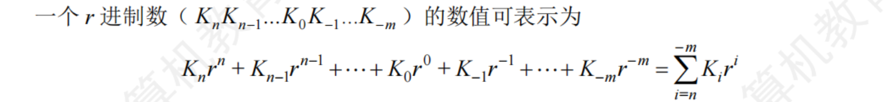
    1. 二进制，⼆进制只有0和1两种数码，计数“逢⼆进⼀”
    2. 八进制，基数为8，有0~7共8个不同的数码。计数逢⼋进⼀
    3. 十六进制，基数为1 6，有0~9、A～F共1 6个不同的数码，其中A～F分别表⽰10~15。计数逢⼗六进⼀

2. 不同进制数之间的相互转换
    1. 二进制数转换为八进制数和十六进制数
    整数部分，从⼩数点开始往左数，将⼀串⼆进制数分为3位（⼋进制）⼀组或4位（⼗六进制）⼀组，在数的最左边可根据需要加“0”补齐；对于⼩数部分，从⼩数点开始往右数，也将⼀串⼆进制数分为3位⼀组或4位⼀组，在数的最右边也可根据需要加“0”补齐。最终使总的位数为3或4的整数倍，然后分别⽤对应的⼋进制数或⼗六进制数取代。

    由⼋进制数或⼗六进制数转换为⼆进制数，只需将每位改为3位或4位⼆进制数即可（必要时去掉整数最⾼位或⼩数最低位的0）。⼋进制数和⼗六进制数之间的转换也能⽅便地实现，⼗六进制数转换为⼋进制数（或⼋进制数转换为⼗六进制数）时，先将⼗六进制（⼋进制）数转换为⼆进制数，然后由⼆进制数转换为⼋进制（⼗六进制）数较⽅便。
    2. 任意进制数转换为十进制数
    将任意进制数的各位数码与它们的权值相乘，再把乘积相加，就得到了⼀个⼗进制数。这种⽅法称按权展开相加法。
    3. 十进制数转换为任意进制数
    除基取余法（整数部分）：整数部分除基取余，最先取得的余数为数的最低位，最后取得的余数为数的最⾼位（除基取余，先余为低，后余为⾼），商为0时结束。

    乘基整数为数的⼩数部分：取整法（⼩数部分2；⼩数部分乘基取整，最先取得的整数为数的最⾼位，最后取得的最低位（乘基取整，先整⼒⾼；后整为低），乘积1.0（或满⾜精度要求〉时结束

### 2.1.2 定点数的编码表示
1. 真值和机器数
带“+”或“_”符号的数称为真值，通常⽤“0”表⽰“正”，⽤“1”表⽰“负”。这种把符号“数字化”的数称机器数

2. 机器数的顶点表示
在计算机中有两种数据格式：顶点表示和浮点表示。在现代计算机中，通常⽤补码整数表⽰整数，⽤原码⼩数表⽰浮点数的尾定点表数部⽰。⽤移码表⽰浮点数的阶码部分

定点表示法用来表示顶点小数和定点整数
    1. 定点小数，定点小数是纯小数
    2. 定点整数，定点整数是纯整数
    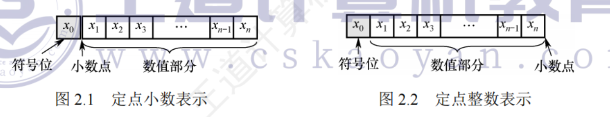

3. 原码、补码、反码、移码
    1. 原码表示法
    用机器数的最高位表示数的符号，其余各位表示数的绝对值
    原码优点：1. 与真值的对应关系简单、直观、与真值的转换简单
            2.用原码实现乘除运算比较简单。
    缺点：1. 0的表示不唯一，有正负两个编码
         2. 用原码实现加减运算比较复杂
    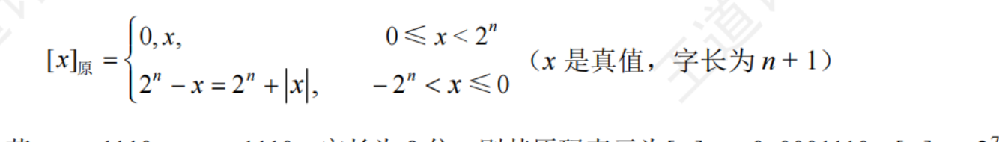
    2. 补码表示法
    补码表⽰法中的加减运算统⼀采⽤加法操作实现。正数的补码和原码相同，负数的补码等于模（n+1位补码的模为2^n+1）与该负数绝对值之差。

    若字长为n+1，则补码整数的表⽰范围为-2^n≤×≤2^n-1（⽐原码多表⽰“-2^n”）。
        •⼏个特殊数据的补码表⽰
        1）[+0]补=[-0]＊＝0,00……（合符号位共n+1个0），说明0的补码表⽰是唯⼀的。
        2）[-1]补 = 2^n+1 - 1 = 1,11……(含符号位共n+1个1)
        3）［2^n-1］补=0,11……1（n个1），即n+1位补码能表⽰的最⼤整数。
        4）[-2^n]=1.00..0（n个0），即n+1位补码能表⽰的最⼩整数。

        模运算
            A、B、M满⾜A=B+K X M（K为整数），记为A模B（m o d.M A），即A、B各除以M后的余数相同。在补码运算中，[A]	补-[B]补=[A]补+M-[B]补，而M-[B]补=[-B]补，因此补码可以借助加法运算来实现减法运算。

    真值转换为补码：对于正数，与原码的⽅式⼀样。对于负数，符号位取1，其余各位由数值部分“按位取反，末位加1”得到。补码转换为真值：若符号位0，与原码的⽅式⼀样。若符号位为1，真值的符号为负，数值部分由补码数值部分“按位取反，末位加1”得到。
    3. 反码表示法
    若符号位为0，则反码与原码相同
    若符号位为1，则数值位全部取反

    4. 移码表示法
    在补码的基础上，将符号为取反，只能表示整数

    移码（假设机器字长为n+1，偏置值2^n）具有以下特点：
    ①移码中零的表⽰唯⼀，[+0]移=2^n + 0 = [-0] 移= 2^n - 0 = 1,00……
    ②⼀个真值的移码和补码仅差⼀个符号位，[x]补的符号位取反即得［x］移（“1”表⽰正，“0”表⽰负，这与其他机器数的符号位取值正好相反），反之亦然。
    ③移码全0时，对应真值的最⼩值-2^n；移码全1时，对应真值的最⼤值2^n-1。
    ④移码保持了数据原有的⼤⼩顺序，移码⼤真值就⼤，移码⼩真值就⼩。

    原码、补码、反码和移码这.4种编码表⽰的总结如下：
    ①原码、补码、反码的符号位相同，正数的机器码相同。
    ②原码、反码的表⽰在数轴上对称，⼆者都存在+0和-0两个0。
    ③补码、移码的表⽰在数轴上不对称，零的表⽰唯⼀，它们⽐原码、反码多表⽰⼀
    ④原码很容易判断⼤⼩。⽽负数的补码、反码很难直接判断⼤⼩，可采⽤如下规个数。则快速判断单对于负数，数值位部分越⼩，其绝对值越⼤，即负得越多

### 2.1.3 整数表示
1. 无符号整数的表示
当⼀个编码的全部⼆进制位均为数值位⽽没有符号位时，该编码表⽰就是⽆符号整数。

2. 有符号整数的表示
将符号数值化，并将符号位放在有效数字的前⾯，就组成了有符号整数
①与原码和反码相⽐，0的补码表⽰唯⼀。
②与原码和移码相⽐，补码运算规则⽐较简单，且符号位可以和数值位⼀起参加运算。
③与原码和反码相⽐，补码⽐原码和反码多表⽰⼀个最⼩负数。
计算机中的有符号整数都⽤补码表⽰，所以n位有符号整数的表⽰范围是-2^n-1～2 ^n-1-1。

### 2.1.4 C语言的整数类型及类型转换
1. C语言中的整型数据类型
2. 有符号和无符号数的转换
无符号数与有符号数：不改变数据内容，改变解释方式
长整数变短整数：高位截断，保留地位
短整数变长整数：符号位扩展
3. 不同字长整数之间的转换
①若从⼩字长转换到⼤字长，则要先对原数字的⾼位部分进⾏扩展，若原数字是⽆符号整数，则进⾏零扩展；若原数字是有符号整数，则进⾏符号扩展。
②若从⼤字长转换到⼩字长，则直接截取低位部分。也就是说，先进⾏字长的转换，再进⾏符号的转换。

## 2.2 运算方法和运算电路
### 2.2.1 基本运算部件
运算器由算术逻辑单元（ALU）、移位器、状态寄存器（PSW）和通⽤寄存器组等组成，ALU的核⼼部件是加法器
1. 一位全加器
全加器（FA）是最基本的加法单元，有加数Ai,加数Bi与低位传来的进位Ci-1共三个输⼊，有本位和Si及向⾼位的进位Ci共两个输出。

全加器的逻辑表达式如下:

和表达式：Si=Ai异或Bi异或Ci-1（当Ai,Bi,Ci-1中有奇数个1时，S i=1，否则Si=0）

进位表达式：C i=AiBi+（Ai异或Bi）Ci-1

2. 串行进位加法器
将n个全加器相连可得到n位加法⾏波进位，称为串⾏进位加法器，串行进位也称行波进位，每级进位直接依赖于前⼀级的进位，即进位信号是逐级形成的。在串⾏进位加法器中，低位运算产⽣进位所需的时间将影响⾼位运算的时间。因此，串⾏进位加法器的最长运算时间主要是由进位信号的传递时间决定的，位数越多，延迟时间就越长，所以加快进位产⽣和提⾼传递的速度是关键。

3. 并行进位加法器
并⾏进位（也称先⾏进位）加法器可以加快进位产⽣的速度，进⽽提升加法运算产⽣结果的速度。作⽤是“并⾏产⽣进位”，即n位进位信息⼏乎是同时产⽣的。因此，相⽐于串⾏进位加法器，并⾏进位加法器提升了加法运算产⽣结果的速度。

4. 带标志加法器
需要在n位加法器的基础上增加⼀些逻辑电路，使其不仅能计算和/差，还能⽣成相应的标志信息：分别是OF、CF、SF和ZF，每个标志信息占1位

溢出标志OF=Cn异或Cn-1，⽤于判断有符号数的加減运算是否溢出，OF=0表⽰未溢出，OF=1表⽰溢出。符号标志SF=Fn-1，⽤于表⽰有符号数的加减运算结果的正负性，SF=0表⽰结果为正，SF=1表⽰结果为负。零标志Z F=1当且仅当F=0，表⽰加减运算的结果是否为0,ZF=1表⽰结果为0，ZF=0表⽰结果⾮0。进位/借位标志C F=Cout异或Cin,⽤于判断⽆符数的加减运算是否发生溢出，CF=0表示未发生溢出,CF=1表示溢出

5. 算数逻辑单元ALU
ALU是⼀种功能较强的组合逻辑电路，它能进⾏多种算术运算和逻辑运算。加、减、乘、除运算最终都能归结为加法运算，因此A L U的核⼼是带标志加法器，同时也能执⾏“与”，“或”，“⾮”等逻辑运算
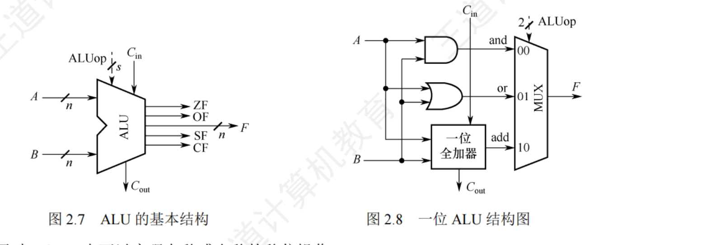

### 2.2.2 定点数的移位运算
1. 逻辑移位
逻辑移位的规则：左移时，⾼位移出，低位补0；右移时，低位移出，⾼位补0。对于⽆符号整数的逻辑左移，若⾼位的1移出，则发⽣溢出。

2. 算术移位
算术移位的规则：左移时，⾼位移出，低位补0，若移出的⾼位不同于移位后的符号位，即左移前后的符号位不同，则发⽣溢出：右移时，低位移出，⾼位补符号位，若低位的1移出，则影响精度

### 2.2.3 定点数的加减运算
1. 补码的加减法运算
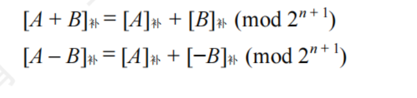

补码运算的特点如下。

    1）按⼆进制运算规则运算，逢⼆进⼀。

    2）若做加法，两个数的补码直接相加；若做减法，则将被减数与减数的负数补码相加。

    3）符号位与数值位⼀起参与运算，加、减运算结果的符号位也在运算中直接得出。

    4）最终运算结果的⾼位丢弃，保留n+1位，运算结果亦为补码。

2. 溢出判别方法
上溢：正+正=负，下溢：负+负=正

两个正数相加，⽽结果的符号位却为1（结果为负）；⼀个负数减去⼀个正数，结果的符号位却为0（结果为正）。

补码定点数加减运算溢出判断的⽅法有3种。
（1）采⽤⼀位符号位

减法运算在机器中是⽤加法器实现的，因此⽆论是加法还是减法，只要参加操作的两个数的符号相同，结果又与原操作数的符号不同，则表⽰结果溢出。设A的符号为A，B的符号为B，运算结果的符号为S，则溢出逻辑表达式为
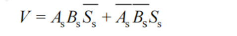

若V=0，表⽰⽆溢出；若V=1，表⽰有溢出。

（2）采⽤双符号位

双符号位法也称模4补码。运算结果的两个符号位Ss1Ss2相同，表⽰未溢出；运算结果的两个符号位Ss1Ss2不同，表⽰溢出，此时最⾼位符号位代表真正的符号。

符号位S s 1 S s 2的各种情况如下：

    ①Ss1Ss2=0 0：表⽰结果为正数，⽆溢出。
    ②S s1Ss2=0 1：表⽰结果正溢出。
    ③S s 1 S s 2=1 0：表⽰结果负溢出。
    ④S s 1 S s 2=1 1：表⽰结果为负数，⽆溢出。

溢出逻辑判断表达式为V=S s 1异或Ss 2，若=0，表⽰⽆溢出；若V=1，表⽰有溢出。

（3）采⽤⼀位符号位根据数值位的进位情况判断溢出

若符号位（最⾼位）的进位Cn与最⾼数位（次⾼位〉的进位Cr-1，相同，说明⽆溢出，否则说明有溢出。溢出逻辑判断表达式为V=Cn异或Cn-1,若V=0，表示无溢出；V=1，表示有溢出明 ⽆ 溢 出 ， 否 则 说明有溢出。溢出逻辑判断表达式为V=Cn异或Cn-1,若V=0，表示无溢出；V=1，表示有溢出

3. 加减运算电路

    无符号减法：
        1. 被减数不变，减数全部按位取反，末位加1，减法变加法

        2. 从最低位开始，按位相加，并往更高位进位

        判断溢出，nbit无符号整数表示范围0～2^n-1,超出则溢出

    无符号加法：从最低位开始，按位相加，并往更高位进位

    零标志ZF:ZF=1表⽰结果F为0。对于⽆符号数和有符号数的运算，ZF都有意义。

    溢出标志OF：判断有符号数运算是否溢出，它是符号位进位与最⾼数位进位的异或结果，即OF=Cn异或Cn-1。对于⽆符号数运算，OF没有意义，通俗地说，就是根据OF⽆法判断⽆符号数运算是否溢出。例如，⽆符号数加法010+011=101，此时OF=1，但结果未溢出。

    符号标志SF：表⽰结果的符号，即F的最⾼位。对于⽆符号数运算，SF没有意义。

    进/借位标志CF：表⽰⽆符号数运算时的进位/借位，判断是否发⽣溢出。加法时，CF=1表⽰结果溢出，因此CF等于进位输出Cout。减法时，CF=1表⽰有借位，即不够减，所以CF等于进位输出Cout取反。综合可得CF=Sub异或Cout。例如，⽆符号数加法110+011最⾼位产⽣进位，⽆符号数减法000-111最高位产生借位，结果均发生溢出(CF=1).对于有符号数计算，CF没有意义，也就是说，根据CF无法判断有符号数运算是否溢出。

        1. 无符号数大小的比较

            对于无符号数的运算。零标志ZF、进/借位标志CF才有意义。假设有两个无符号数A和B，当ZF=1时，说明A=B。当ZF=0且CF=0时，说明A>B.当CF=1时，说明A<B.

        2. 有符号数大小的比较

            对于有符号数的运算，零标志ZF、溢出标志OF、标志符号SF才有意义。假设有两个符号数A和B，用补码表示，当ZF=1时，说明A=B。当OF=SF（或OF异或SF=0）且ZF=0时，说明A>B.当OF不等于SF（或OF异或SF=1）且ZF=0时，说明A<B.

4. 原码的加减法运算

    加法规则：遵循茼蒿求和，异号求差
    减法规则：先将减数的符号取反，然后将被减数与符号取反后的减数按原码加法进行运算

### 2.2.4 定点数的乘除运算
1. 定点乘法运算

    1. 乘法运算的基本原理

        原码乘法的特点是符号位与数值位是分开的，原码乘法运算分为两步：

            1. 乘积的符号位由两个乘除的符号位“异或”得到。

            2. 乘积的数值位是两个乘数的绝对值之积。

        两个定点数的数值部分之积可视为两个无符号数的乘积

        原码乘法运算过程可归纳如下：

            1. 被乘数和成熟均取绝对值参加运算，视为无符号数，符号位为Xs异或Ys

            2. 部分积Pi是乘法运算的中间结果，初值P0=0.从乘数的最低位Yn开始，将前面所得的部分积Pi加上X*Yn-1，然后右移一位，此步骤重复n次。

    2. 乘法运算电路

        部分积和被乘数X做⽆符号数加法时，可能产⽣进位，因此设置⼀个专门的进位位C。乘积寄存器P初始置0。计数器Cn初值为32，每循环⼀次减1。ALU是乘法器的核⼼部件，对乘积寄存器P和被乘数寄存器X的内容做“⽆符号加法”运算，结果送回乘积寄存器P，进位存放在C中。每次循环都对进位位C、寄存器P和寄存器Y实现同步“逻辑右移”，此时，进位位C移⼊寄存器P的最⾼位，寄存器Y的最低位移出。每次从寄存器Y移出的最低位都被送到控制逻辑，以决定被乘数是否“加到部分积上。

        在字长为32位的计算机中，对于两个int型变量x和y的乘积，若乘积⾼32位的每⼀位都相同，且都等于乘积低32位的符号，则表⽰不溢出，否则表⽰溢出。当x和y都为unsignedint型变量时，若乘积的⾼3 2位全为0，则表⽰不溢出，否则表⽰溢出。

2. 除法运算

    1.除法运算的基本原理

        原码的除法运算与乘法复杂。n位定点数的除法运算，需统运算很相似，都是⼀种移位和加减运算迭代的过程，但比乘法更复杂。n位定点数的除法运算，需统一为：⼀个2n位的数除以⼀个n位的数，得到⼀个n位的商，因此需要对被除数进⾏扩展。对于定点正⼩数（原码⼩数），只需在被除数低位添n个0即可。对于定点正整数（⽆符号数），只需在被除数⾼位添n个0即可。做整数除法时，若除数⼒0，则发⽣“除数为O”异常，此时需调出操作系统相应的异常处理程序进⾏处理。

        除法运算的过程可归纳如下：
        ①被除数与除数相減，够减则上商为1，不够减则上商为0。
        ②每次得到的差为中间余数，将除数右移后与上次的中间余数⽐较。⽤中间余数减除数，
        够减则上商为1，不够减则上商为0。如此重复，直到商的位数满⾜要求为⽌。

    2. 除法运算电路

        寄存器Y存放除数；寄存器R初始时存放扩展被除数的⾼32位，运算过程中存放中间余数的⾼位部分，结束时存放的是余数：寄存器Q初始时存放扩展被除数的低32位，运算过程中部分存放中间余数的低位部分、部分存放商，结束时存放的是32位商。ALU是除法器的核⼼部件，对寄存器R和Y的内容做加/减运算，运算结果被送回寄存器R。计数器Cn初值为32，每循环⼀次减1。每次循环，寄存器R和Q实现同步左移，左移时，Q的最⾼位移⼊R的最低位，Q中空出的最低位被上商。从低位开始，逐次把商的各个数位左移到Q中。每次由控制逻辑根据ALU运算结果的符号来决定上商是0还是1。

        若是两个32位int型整数相除，则除了-2^31/-1会溢出，其余情况都不会溢出。

## 2.3 浮点数的表示与运算
### 2.3.1 浮点数的表示
1. 浮点数的表示格式
    N=(-1)^s*M*R^E

    S取值0或1，⽤来决定浮点数的符号；M是⼀个⼆进制定点⼩数，称为尾数，⼀般⽤定点原码⼩数表⽰；E是⼀个⼆进制定点整数，称为阶码或指数，⽤移码表⽰。R是基数（隐含），可以约定为2、4、1 6等。可见浮点数由符号、尾数和阶码三部分组成
    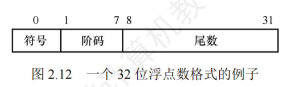

    第0位为符号S：第1～7位移码表⽰的阶码E（偏置值64）；第8~31位24位⼆进制原码⼩数表⽰的尾数M；基数R为2。阶码的值反映浮点数的⼩数点的实际位置；阶码的位数反映浮点数的表⽰范围；尾数的位数反映浮点数的精度。

2. 浮点数的表示范围

    原码是关于原点对称的，所以浮点数的范围也是关于原点对称的。

    运算结果⼤于最⼤正数时称为正上溢，⼩于绝对值最⼤负数时称为负上溢，正上溢和负上溢统称上溢。数据⼀旦产⽣上溢，计算机必须中断运算操作，进⾏溢出处理。当运算结果在0⾄最⼩正数之间时称为正下溢，在0⾄绝对值最⼩负数之间时称负下溢，正下溢和负下溢统称下溢。数据下溢时，浮点数值趋于零，计算机将其当作机器零处理。

3. 浮点数的规格化

    规格化操作，是指通过调整⼀个⾮规格化浮点数的尾数利阶码的⼤⼩，使⾮零浮点数在尾数的最⾼数位上保证是⼀个有效值。

    左规：当运算结果的尾数的最⾼数位不是有效位，即出现正负0.0..0x..x的形式时，需要进⾏左规。左规时，尾数每左移⼀位、阶码減1（基数为2时）。左规可能要进⾏多次。

    右规：当运算结果的尾数的有效位进到⼩数点前⾯时，需要进⾏右规，右规只需进⾏⼀次。将尾数右移⼀位：阶码加1了基数为2时）。右规时，阶码增加可能导致溢出。

    基数为2的原码规格化尾数M应满⾜1/2≤|M|＜1，形式如下：①正数为0.1 x...×的形式，最⼤值为0.11...1，最⼩值为0.100..0，表⽰范围为1/2≤M≤(1-2^-n);②负数1.1 x...x的形式，最⼤值1.10...0，最⼩值为1.11...1，表⽰范围为-（1-2）≤M≤-1/2。

    基数不同，浮点数的规格化形式也不同。当浮点数尾数的基数为2时，原码规格化数的尾数最⾼位⼀定是1。当基数为4时，原码规格化数的尾数最⾼两位不全为0。

4. IEEE754标准

    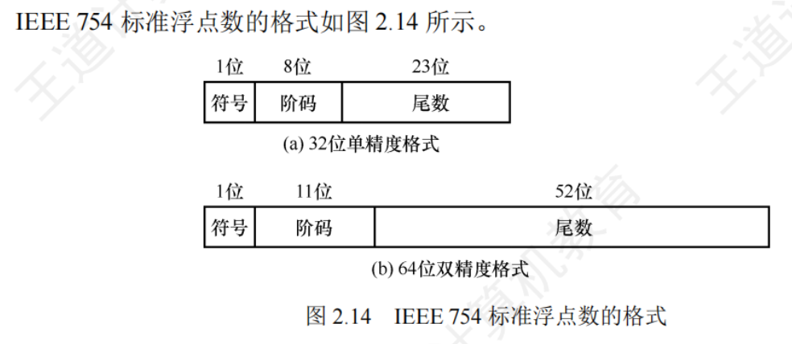
    IEEE754标准规定常⽤的浮点数格式有3 2位单精度浮点数（短浮点数、float型）和64位双精度浮点数（长浮点数、double型），其基数隐含为2

    单精度格式中包含1位符号s、8位阶码e和23位尾数f：双精度格式包含1位符号s、11位阶码e和52位尾数f。基数隐含为2：尾数⽤原码表⽰。对于规格化的⼆进制浮点数，尾数的最⾼位总是1，为了能使尾数多表⽰⼀位有效位，将这个1隐藏，称为隐藏位，因此2 3位尾数实际表⽰了24位有效数字。IEEE754规定隐藏位.1的位置在⼩数点之前。

    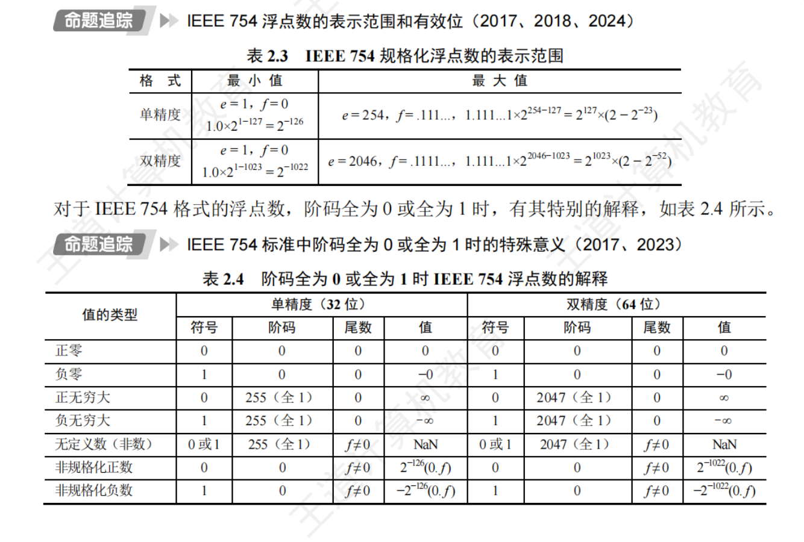

    1）全0阶码全0尾数：+0/-0。零的符号取决于符号s，⼀般情况下+0和-0是等效的。

    2）全1阶码全0尾数：+∞/-∞。+∞在数值上⼤于所有有限数，-∞则⼩于所有有限数。引⼊⽆穷⼤数的⽬的是，在计算过程出现异常的情况下使得程序能继续进⾏下去。

    3）全1阶码⾮0尾数：NaN（NotaNumber）。表⽰⼀个没有定义的数，称为⾮数。

    4）全0阶码⾮0尾数：⾮规格化数。⾮规格化数的特点是阶码全0，尾数⾼位有⼀个或⼏个连续的0，但不全为0。因此，⾮规格化数的隐藏位为0，且单精度和双精度浮点数的指数分别为-126或-1022。⾮规格化数可以⽤于处理阶码下溢.

5. 定点、浮点表示的区别

    1. 数值的表示范围

        若定点数和浮点数的字长相同，则浮点表示法所能表示的数值范围远大于定点表示法

    2. 精度

        对于字长相同的定点数和浮点数来说，浮点数虽然扩大了数的表示范围，但精度降低了。

    3. 数的运算

        浮点数包括阶码和尾数两部分，运算时不仅要做尾数的运算，还要做阶码的运算，而且运算结果要求规格化，所以浮点数运算比定点运算复杂。

    4. 溢出问题

        在定点运算中，当运算结果超出数的表示范围时，发生溢出；在浮点运算中，运算结果超出尾数表示范围却不一定溢出，只有规格化后阶码超出所能表示的范围时，才发生溢出。

### 2.3.2 浮点数的加减运算
1. 对阶

    对阶的⽬的是使两个操作数的⼩数点位置对齐，即使得两个数的阶码相等。先求阶码差，以⼩阶码向⼤阶码看齐的原则，将阶码⼩的尾数右移⼀位（基数內2），阶码加1，直到两个数的阶码相等为⽌。若采⽤⼤阶码向⼩阶码看齐的原则，则尾数需要左移，最⾼有效位被移出，导致结果出错

2. 尾数加减

    将对阶后的尾数按定点原码⼩数的加（減）运算规则进⾏运算。运算后的尾数不⼀定是规格化的，因此，浮点数的加减运算需要进⼀步进⾏规格化处理。

3. 尾数规格化

    IEEE754规格化尾数的形式为正负1.x...×。尾数相加减后会得到各种可能结果，例如：

    1.x....×+1.x...x=正负1x.x...x

    1.x.....x-1.x...x=正负0.0...01x...x

    1）右规：当结果为正负1x.x...x时，需要进⾏右规。尾数有移⼀位，阶码加1。尾数右移时，最⾼位1被移到⼩数点前⼀位作为隐藏位，最后⼀位移出时，要考虑舍⼊。

    2）左规：当结果正负0.0..0 1×..x时，需要进⾏左规。尾数每左移⼀位，阶码减1。可能需要左规多次，直到将第⼀位1移到⼩数点左边。

    注意①左规⼀次相当于乘以2，右规⼀次相当于除以2；②需要右规时，只需进⾏⼀次

4. 舍入

    1. 就近舍⼊：舍⼊为最近的可表⽰数。当运算结果是两个可表⽰数的⾮中间值时，实际上是“0舍1⼊”⽅式（类似于⼗进制的“四舍五⼊”法）；当运算结果正好在两个可表⽰数的中间时，则选择结果为偶数。

    2. 正向舍入：朝数轴+∞⽅向舍⼊，即取右边最近的可表⽰数。

    3. 负向判断：朝数轴-∞⽅向舍⼊，即取左边最近的可表⽰数。

    4. 截断法：直接截取所需位数，丢弃后⾯的所有位，这种舍⼊处理最简单。对正数或负数来说，都是取更接近原点的那个可表⽰数，是⼀种趋向原点的舍⼊

5. 溢出判断

    若一个正指数超过了最大允许值，则发生指数上溢，产生异常。若一个负指数超过了最小允许值，则发生指数下溢，通常把结果按机器零处理。

    1. 右规和尾数舍入。数值很大的尾数舍入时，可能因为末位加1而发生尾数溢出，此时需要通过右规来调整尾数和阶码

    2. 左规。左规时阶码减1，导致阶码减小，因此需要判断是否发生了指数下溢。

### 2.3.3 C语言中的浮点数类型

不同类型数的混合运算时，遵循的原则是类型提升，即较低类型转换⼒较⾼类型。如long型与int型⼀起运算时，需先将int型转换为long型，然后进⾏运算，结果为long型。若float型和double型⼀起运算，虽然两者同为浮点型，但精度不同，则仍需先将f o a t型转换为double型后再进⾏运算，结果亦为double型。所有这些转换都是系统⾃动进⾏的，这种转换称为隐式类型转换。

1）int型转换float型时，虽然不会发⽣溢出，但float型尾数连隐藏位共24位，int型为32位，当int型数转换成浮点数的尾数的有效位⼤于24位时，需舍⼊处理，影响精度。

2）int型或float型转换为double型时，因double型的有效位数更多，因此能保留精确值。

3）double型转换次float型时，因float型的表⽰范围更⼩，因此⼤数转换时可能发⽣溢出。此外，尾数有效位数变少，因此⾼精度数转换时会发⽣舍⼊。

4）float型或double型转换⼒int型时，因int型没有⼩数部分，因此数据会向0⽅向截断（仅保留整数部分），发⽣舍⼊。另外，因int型的表⽰范围更⼩，因此⼤数转换时可能溢出

### 2.3.4 数据的大小端和对齐存储
1. 数据的“大端方式”和“小端方式”存储

    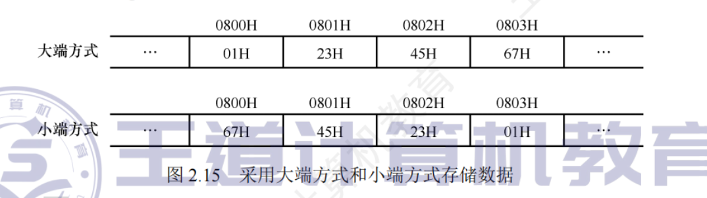

    1. ⼤端⽅式：先存储⾼位字节，后存储低位字节。字中的字节顺序和原序列的相同。
    2. ⼩端⽅式：先存储低位字节，后存储⾼位字节。字中的字节顺序和原序列的相反。

2. 数据按“边界对齐”方式存储

    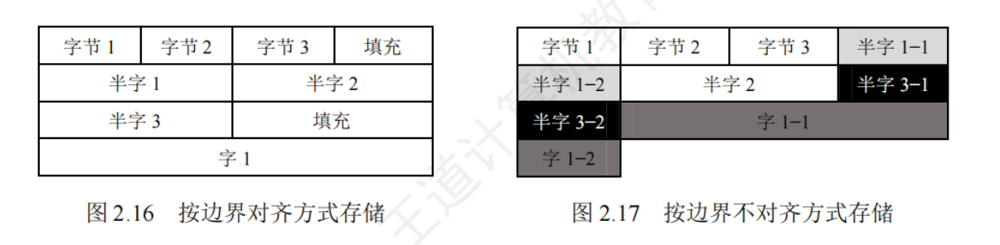

    在C语⾔的struct类型中，边界对齐有两个重要要求：

        ①每个成员按其类型的⼤⼩对齐，char型的对齐值为1，short型的对齐值为2，int型的对齐值为4，单位为字节；

        ②struct的长度必须是成员中最⼤对齐值的整数倍（不够就补空字节）。

# 3 存储系统
## 3.1 存储器概述
### 3.1.1 存储器的分类
1. 按在计算机中的作用分类

    1. 主存储器。简称主存，也称内存储器（内存），⽤来存放计算机运⾏期间所需的程序和数据，CPU可以直接随机地对其进⾏访问，也可以和⾼速缓冲存储器（Cache）及辅助存储器交换数据。其特点是容量较⼩、存取速度较快、单位成本较⾼。

    2. 辅助存储器。简称辅存，也称外存储器或外存，⽤来存放当前暂时不⽤的程序和数据，以及⼀些需要永久性保存的信息。辅存的内容需要调⼊主存后才能被CPU访问。其特点是容量⼤、存取速度较慢、单位成本低。

    3. ⾼速缓冲存储器。简称Cache，位于主存和CPU之间，⽤来存放当前CPU经常使⽤的指令和数据，以便CPU能⾼速地访问它们。Cache的存取速度可与CPU的速度相匹配，但存储容量⼩、价格⾼。现代计算机通常将它们制作在CPU中。

2. 按存储介质分类

    按存储介质，存储器可分为磁表⾯存储器（磁盘、磁带）、磁芯存储器、半导体存储器（MOS型存储器、双极型存储器）和光存储器（光盘）

3. 按存取方式分类

    1. 随机存储器（RAM）。存储器的任何⼀个存储单元都可以随机存取，⽽且存取时间与存储单元的物理位置⽆关。其优点是读/写⽅便、使⽤灵活，主要⽤作主存或⾼速缓冲存储器。

    2. 只读存储器（ROM）。存储器的内容只能随机读出⽽不能写⼊。信息⼀旦写⼊存储器就固定不变，即使断电，内容也不会丢失。因此，通常⽤它存放固定不变的程序、常数和汉字字库等。仑与随机存储器可共同作为主存的⼀部分，统⼀构成主存的地址域

    3. 串行访问存储器。对存储单元进行读/写操作时，需按其物理地址位置的先后顺序寻址，包括顺序存取存储器和直接存取存储器。

    顺序存取存储器的内容只能按某种顺序存取，存取时间的长短与信息在存储体上的物理位置有关，其特点是存取速度慢。直接存取存储器既不像RAM那样随机地访问任何⼀个存储单元，又不像顺序存取存储器那样完全按顺序存取，⽽是介于两者之间。存取信息时通常先寻找整个存储器中的某个⼩区域（如磁盘上的磁道），再在⼩区域内顺序查找

4. 按信息的可保存性分类

    断电后，存储信息即消失的存储器，称为易失性存储器，如RAM。断电后信息仍然保持的存储器，称为⾮易失性存储器，如ROM、磁表⾯存储器和光存储器。

    若某个存储单元所存储的信息被读出时，原存储信息被破坏，则称破坏性读出；若读出时，被读单元原存储信息不被破坏，则称⾮破坏性读出。具有破坏性读出性能的存储器，每次读出操作后，必须紧接⼀个再⽣的操作，以便恢复被破坏的信息。

### 3.1.2 存储器的性能指标
存储器有三个主要性能指标，即存储容量、单位成本和存储速度

1. 存储容量=存储字长*字长。存储字数表示存储器的地址空间大小，字长表示一次存取操作的数据量。

2. 单位成本：位价=总成本/总容量

3. 存储速度：数据传输速率（每秒传送信息的位数）=数据的宽度/存取周期。

    1. 存取时间Ta：寻取时间是指从启动一次存储器操作到完成该操作所经历的时间，分为读出时间和写入时间

    2. 存取周期Tm：存取周期是指存储器进行一次完整的读/写操作所需的全部时间，即连续两次独立访问存储器操作之间所需的最小时间间隔。

    3. 主存宽带Bm：也称数据传输速率，表示每秒从主存进出信息的最大数量，单位为字/秒、字节/秒或位/秒。

    存取时间不等于存取周期，通常存取周期大雨存取时间。在读/写操作之后，总要有一段恢复内部状态的复原和时间。对于破坏性读出的存储器，存取周期往往比存取时间大的多，甚至Tm=2Ta,因为存储器中的信息读出后需要马上进行再生。
    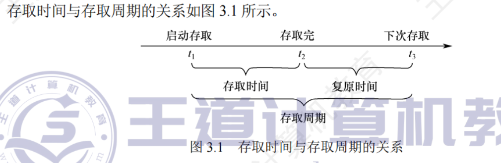

### 3.1.3 多级层次的存储系统
在图中由上至下，位价越来越低，速度越来越慢，容量越来越大，CPU访问的频度也越来越低。存储系统层次结构主要体现在Cache-主存层和主存-辅存层。在存储体系中，Cache、主存能与CPU直接交换信息，辅存则要通过主存与CPU交换信息：主存与CPU、Cache、幅存都能交换信息。

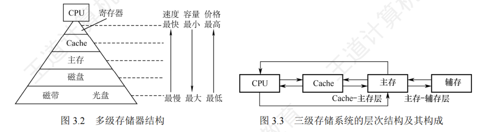

存储器层次结构的主要思想是上⼀层的存储器作为低⼀层存储器的⾼速缓在。当CPU要从存储器中存取数据时，先访问Cache，若不在Cache中，则访问主存，若不在主存中，则访问磁盘，此时，操作数从磁盘读出送到主存，然后从主存送到Cache。从CPU的⾓度看，Cache-主存层的速度接近于Cache，容量和位价却接近于主存。从主存-辅存层分析，其速度接近于主存，容量和位价却接近于辅存。这就解决了速度、容量、成本这三者之间的⽭盾。

Cache-主存层主要解决CPU和主存速度不匹配的问题，主存和Cache之间的数据调动是由硬件⾃动完成的，对所有程序员均是透明的。主存-辅存层主要解决存储系统的容量问题，主存和辅存之间的数据调动是由硬件和操作系统共同完成的，对应⽤程序员是透明的

在主存-辅存层的不断发展中，逐渐形成了虚拟存储系统，在这个系统中程序员编程的地址与虚拟存储器的地址空间相对应，编程时可⽤的地址空间远⼤于主存空间

## 3.2 主存储器
### 3.2.1 SRAM芯片和DRAM芯片
半导体存储器分随机存储器（RAM）和只读存储器（ROM）。RAM又分静态随机存储器（SRAM）和动态随机存储器（DRAM），主存储器主要由DRAM实现，靠近处理器的那⼀层（Cache）则由SRAM实现，它们都是易失性存储器。ROM是⾮易失性存储器。

1. SRAM的工作原理

    通常把存放⼀个⼆进制位的物理器件称为存储元，它是存储器的最基本的构件。地址码相同的多个存储元构成⼀个存储单元。若⼲存储单元的集合构成存储体。

    静态随机存储器（SRAM）的存储元是⽤双稳态触发器（六晶体管MOS）来记忆信息的，静态是指即使信息被读出后，它仍保持其原状态⽽不需要再⽣（⾮破坏性读出）。

    SRAM的存取速度快，但集成度低，功耗较⼤，价格昂贵，⼀般⽤于⾼速缓冲存储器。

2. DRMA的工作原理

    动态随机存储器（DRAM）是利⽤存储元电路中栅极电容上的电荷来存储信息的，DRAM的基本存储元通常只使⽤⼀个晶体管，所以它⽐SRAM的密度要⾼很多。相对于SRAM来说，DRAM具有集成度⾼、位价低和功耗⼩等优点，但DRAM的存取速度⽐SRAM慢，且必须定时刷新和读后再⽣，⼀般⽤于⼤容量的主存系统。

    DRAM电容上的电荷⼀般只能维持1～2ms，因此即使电源不断电，信息也会⾃动消失。此外，读操作会使其状态发⽣改变（破坏性读出），需读后再⽣，这也是称其为动态存储器的原因。刷新可以采⽤读出的⽅法进⾏，根据读出内容对相应单元进⾏重写，即读后再⽣。对同⼀⾏进⾏相邻两次刷新的时间间隔称为刷新周期，通常取2ms。常⽤的刷新⽅式有以下3种：

        1. 集中刷新：在⼀个刷新周期内，利⽤⼀段固定的时间，依次对存储器的所有⾏进⾏逐⼀再⽣，在此期间停⽌对存储器的读/写操作，称死时间，也称访存死区。优点是读/写操作期间不受刷新操作的影响；缺点是在集中刷新期间（死区）不能访问存储器。

        2. 分散刷新：将⼀个存储器系统的⼯作周期分为两部分：前半部分⽤于正常的读/写操作；后半部分⽤于刷新。这种刷新⽅式增加了系统的存取周期，如存储芯⽚的存取周期为0。5uS，则系统的存取周期为1us。优点是没有死区：缺点是加长了系统的存取周期。

        3. 异步刷新：结合了前两种⽅法，使得在⼀个刷新周期内每⼀⾏仅刷新⼀次。具体做法是将刷新周期除以⾏数，得到相邻两⾏之间刷新的时间间隔t，每隔时间t产⽣⼀次刷新请求。这样就使“死时间”的分布更加分散，避免让C P U连续等待过长的时间。

    DRAM的刷新需要注意以下问题：
        ①刷新对CPU是透明的，即刷新不依赖于外部的访问；
        ②DRAM的刷新单位是⾏，由芯⽚内部⾃⾏⽣成⾏地址；
        ③刷新操作类似于读操作，但又有所不同；
        另外，刷新时不需要选片，即整个存储器中的所有芯片同时被刷新。

    DRAM芯⽚容量较⼤，地址位数较多，为了减少芯⽚的地址引脚数，通常采⽤地址引脚复思技术，⾏地址和列地址通过相同的引脚分先后两次输⼊，这样地址引脚数可减少⼀半。

    假定有⼀个2^n*b位DRAM芯⽚的存储阵列，其⾏数为r，列数为c，则2^n=r*c。存储阵列的地址位数为n，其中⾏地址位数为log2^n，列地址位数为log2^c，则n=log2^r+log2^c。由于DRAM芯⽚采⽤地址引脚复⽤技术，为减少地址引脚数，应尽量使⾏、列位数相同，即满⾜|r-c|最⼩。又由于DRAM按⾏刷新，为减少刷新开销，应使⾏数较少，因此还需满⾜r≤C。

    ⽬前更常⽤的是SDRAM（同步DRAM）芯⽚，与传统的异步DRAM不同，SDRAM与CPU的数据交换同步于系统的时钟信号，并且以CPU-主存总线的最⾼速度运⾏，⽽不需要插⼊等待状态。在传统DRAM中，CPU将地址和控制信号送⾄存储器后，需经过⼀段延迟时间，数据才读出或写⼊。在此期间，CPU不断采样DRAM的完成信号，在读写完成之前，CPU不能做其他⼯作，降低了CPU的执⾏速度。⽽SDRAM在系统时钟的控制下进⾏数据的读出和写⼊，它将CPU发出的地址和控制信号锁存起来，经过指定的时钟周期数后再响应，此时CPU可执⾏其他操作。

3. SRAM和DRAM的比较
    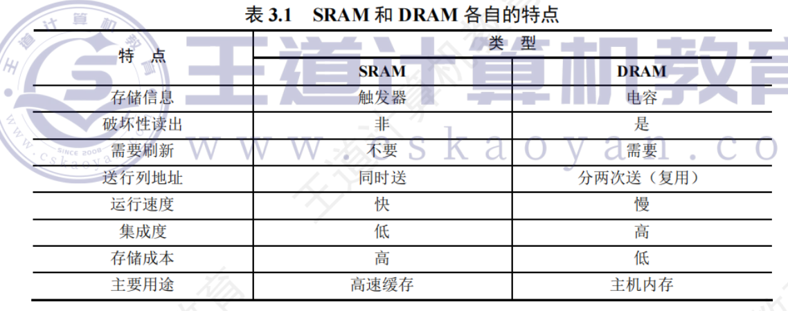

4. 存储器芯片的内部结构
    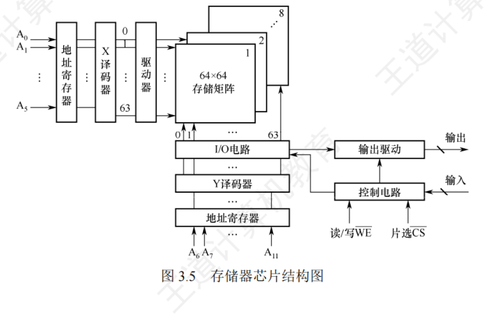

    1. 存储体。存储体是存储单元的集合，它由⾏选择线（X）和列选择线（Y）来选择所访问单元，存储体的相同⾏、列上的多位（位平⾯数）同时被读出或写⼊。

    2. 地址译码器。⽤来将地址转换为译码输出线上的⾼电平，以便驱动相应的读/写电路。地址译码有单译码法（⼀维译码）和双译码法（⼆维译码）两种⽅式。

        1.单译码法。只有⼀个⾏译码器，同⼀⾏中所有存储单元的字线连在⼀起，同⼀⾏中的各单元构成⼀个字，被同时读出或写⼊。缺点是地址译码器的输出线数过多。

        2. 双译码法。如图所⽰，地址译码器分为X和Y两个译码器，在选中的⾏和列交叉点上能确定⼀个存储单元，这是D R A M芯⽚⽬前普遍采⽤的译码结构。

        3. I/O电路。⽤以控制被选中的单元的读出或写⼊，具有放⼤信号的作⽤。

        4. ⽚选控制线。单个芯⽚容量太⼩，往往满⾜不了计算机对存储器容量的要求，因此需⽤⼀定数量的芯⽚进⾏存储器的扩展。在访问某个字时，必须“选中”该存储字所在的芯⽚，⽽其他芯⽚不被“选中”，因此需要有⽚选控制信号（经⽚选控制线传输）。

        5. 读/写控制线。根据CPU给出的读命令或写命令，经读/写控制线控制被选中单元进⾏读或写。

### 3.2.2 只读存储器
1. 只读存储器ROM的特点

    ROM和RAM都是⽀持随机访问的存储器，其中SRAM和DRAM均为易失性半导体存储器。⽽ROM中⼀旦有了信息，就不能轻易改变，即使掉电也不会丢失。ROM具有两个显著的优点：1. 结构简单，所以位密度⽐可读/写存储器的⾼。2. 具有⾮易失性，所以可靠性⾼

2. ROM的类型

    ROM可分为掩模式只读存储器（MROM）、⼀次可编程只读存储器（PROM）、可擦除可编程只读存储器（EPROM）、Flash存储器和固态硬盘（SSD）

    1. 掩模式只读存储器

        MROM的内容由半导体制造⼚商按⽤户提出的要求在芯⽚的⽣产过程中直接写⼊，写⼊以后任何⼈都⽆法改变其内容。优点是可靠性⾼、集成度⾼、价格便宜；缺点是灵活性差。

    2. 一次可编程只读存储器

        PROM是可以实现⼀次性编程的只读存储器，允许⽤户利⽤专门的设备（编程器）写⼊⾃⼰的程序，⼀旦写⼊，内容就⽆法改变。

    3. 可擦除可编程只读存储器

        EPROM不仅可以由⽤户利⽤编程器写⼊信息，⽽且可以对其内容进⾏多次改写。EPROM虽然既可读又可写，但它不能取代RAM，因为EPROM的编程次数有限，且写⼊时间过长。

    4. Flash存储器

        Flash存储器是在EPROM的基础上发展起来的，它兼有ROM和RAM的优点，可在不加电的情况下长期保存信息，又能在线进⾏快速擦除与重写。Flash存储器既有EPROM价格便宜、集成度⾼的优点，又有E^2PROM电可擦除重写的特点，且擦除重写的速度快。

    5. 固态硬盘SSD

        基于闪存的固态硬盘是⽤固态电⼦存储芯⽚阵列制成的硬盘，由控制单元和存储单元（Flash芯⽚）组成。保留了Flash存储器长期保存信息、快速擦除与重写的特性。对⽐传统硬盘也具有读/写速度快、低功耗的特性，缺点是价格较⾼。

### 3.2.3 主存储器的基本组成
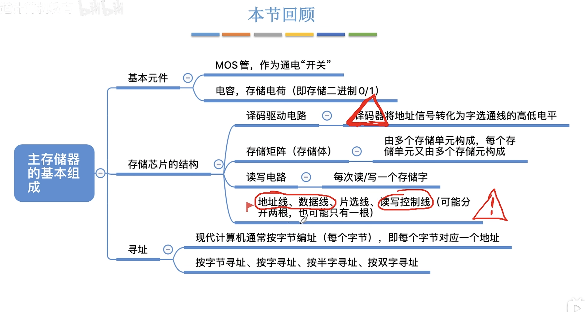

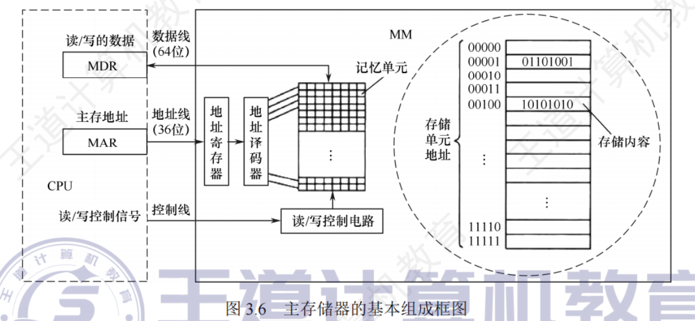

指令执⾏过程中需要访向主存时，CPU首先把被访问单元的地址送到MAR中，然后通过地址线将主存地址送到主存中的地址寄存器，以便地址译码器进⾏译码，选中相应单元，同时CPU将读/写控制信号通过控制线送到主存的读/写控制电路。若是写操作，则CPU同时将要写的信息送到MDR中，在读/写控制电路的控制下，经数据线将信号写⼊选中的单元；若是读操作，则主存读出选中单元的内容送⾄数据线，然后被送到MDR中。MDR的位数与数据线的位数相同，MAR的位数与地址线的位数相同。图采⽤64位数据线，所以在按字节编址⽅式下，每次最多可以存取8个单元的内容。地址线的位数决定了主存地址空间的最⼤可寻址范围。例如，36位地址的最⼤寻址范围为0~2^36-1，即地址从0开始编号。

### 3.2.4 多模块存储器
多模块存储器是一种空间并行技术，利用多个结构完全相同的存储模块的并行工作来提高存储器的吞吐率。

1. 单体多字存储器

    在单体多字系统中，每个存储单元存储m个字，总线宽度也为m个字，⼀次并⾏读出m个字。在⼀个存取周期内，从同⼀地址取出m条指令，然后将指令逐条送⾄CPU执⾏，即每隔1/m存取周期，CPU向主存取⼀条指令。这显然提⾼了单体存储器的⼯作速度。

    缺点：只有指令和数据在主存中连续存放时，这种⽅法才能有效提升存取速度。⼀旦遇到转移指令，或操作数不能连续存放时，这种⽅法的提升效果就不明显。

2. 多体并行存储器

    多体并⾏存储器由多体模块组成。每个模块都有相同的容量和存取速度，各模块都有独⽴的读/写控制电路、地址寄存器和数据寄存器。它们既能并⾏⼯作，又能交叉⼯作。

    多体并⾏存储器分为⾼位交叉编址和低位交叉编址两种。

    1. ⾼位交叉编址（顺序⽅式）
        ⾼位地址表⽰模块号（或体号），低位地址为模块内地址（或体内地址）
        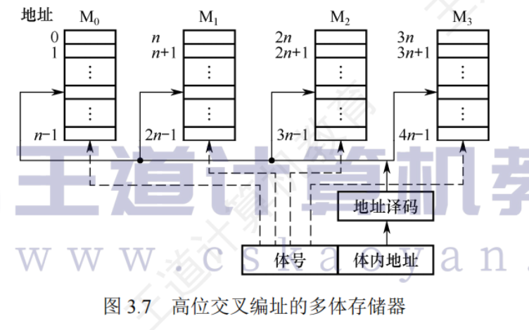

        在⾼位交叉⽅式下，总把低位的体内地址送到由⾼位体号确定的模块内进⾏译码。访问⼀个连续主存块时，总是先在⼀个模块内访问，等到该模块访问完才转到下⼀个模块访问，CPU总是按顺序访问存储模块，各模块不能被并⾏访问，因此不能提⾼存储器的吞吐率

    2. 地位交叉编址（交叉方式）

        低位地址模块号，⾼位地址为模块内地址。如图所⽰，每个模块按“模m”交叉编址，模块号=单元地址%m，假定有m个模块，每个模块有k个单元，则单元O,m，… ，（k-1）m位于M0；单元1,m+1，…，（k-1）m+1位于M1；以此类推。

        在低位交叉⽅式下，总是把⾼位的体内地址送到由低位体号所确定的模块内进⾏译码。程序连续存放在相邻模块中，因此称采⽤此编址⽅式的存储器为交叉存储器。

        交叉存储器可以采⽤轮流启动或同时启动两种⽅式。
            1. 轮流启动⽅式

                若每个模块⼀次读/写的位数正好等于数据总线位数，模块的存取周期为T，总线周期为r，为实现轮流启动⽅式，存储器地址交叉模块数应⼤于或等于m=T/r
                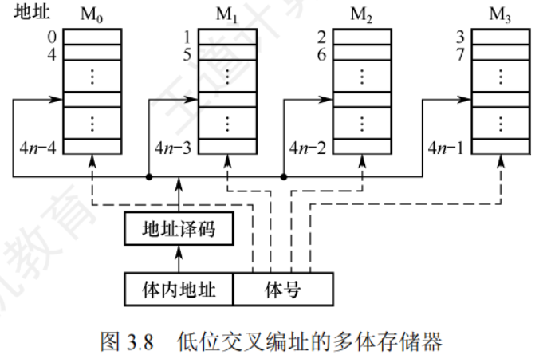

            按每隔1/m个存取周期轮流启动各模块，则每隔1/m个存取周期就可读出或写⼊⼀个数据，存取速度提⾼m倍，图展⽰了4体交叉轮流启动的时间关系。交叉存储器要求其模块数⼤于或等于m，以保证启动某模块后经过m*r的时间后再次启动该模块时，其上次的存取操作已经完成（以保证流⽔线不间断）。这样，连续存取m个字所需的时间为t=T+（m-1）r 而顺序方式连续读取m个字所需的时间t2=mT.交叉存储器的带宽大大提高

            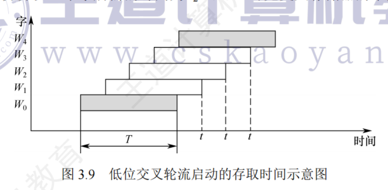

            在理想情况下，m体交叉存储器每隔1/m存取周期可读/写⼀个数据，若相邻的m次访问的
            访存地址出现在同⼀个模块内，则会发⽣访存冲突，此时需延迟发⽣冲突的访问请求。

            2. 同时启动⽅式

            若所有模块⼀次并⾏读/写的总位数正好等于数据总线位数，则可以同时启动所有模块进⾏读/写。设每个模块⼀次读/写的位数为16位，模块数m=4，数据总线位数为64位，4个模块⼀共提供64位，正好构成⼀个存储字，因此应该同时启动4个模块进⾏并⾏读/写。
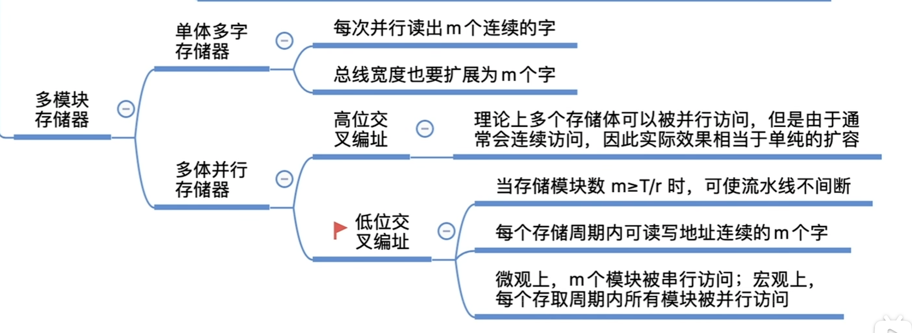
## 3.3 主存储器与CPU的连接
### 3.3.1 连接原理
